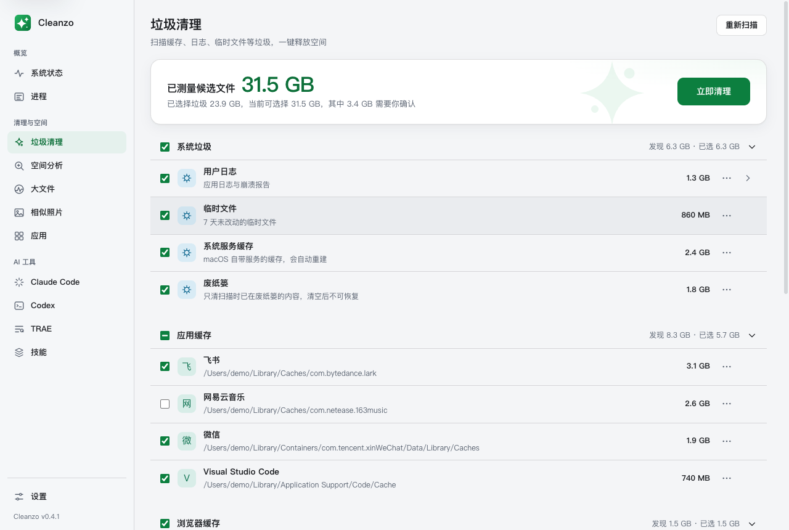

# Cleanzo

[简体中文](README.md) | English

**A macOS / Windows cleaner that shows how much space AI and developer tools take, and lets you get it back.**

Free and open source (MIT) · a single native Go binary, installer about 5 MB · no administrator rights · no account, no telemetry · every item is listed before anything is deleted, and you can stop at any time

[](https://github.com/echoVic/cleanzo/releases)
[](LICENSE)




## Install

On macOS, use Homebrew:

```sh
brew install --cask echoVic/tap/cleanzo
```

Or download from [Releases](https://github.com/echoVic/cleanzo/releases):

- **macOS 12+ (Apple silicon)**: `cleanzo-<version>-arm64.dmg`; open it and drag Cleanzo into Applications. Signed with a Developer ID and notarized by Apple.
- **Windows 10/11 x64**: `cleanzo-setup-<version>-amd64.exe`, installed per user. It needs WebView2 (included in Windows 11). The installer isn't signed, so SmartScreen may warn; choose More info → Run anyway.

## Features

- **Junk cleanup**: grouped into system junk, app caches, browser caches, update leftovers, developer tools, items that need confirmation, and custom folders. Expand each item and stop at any time. Regenerable caches are deleted; your own files only go to the Trash.
- **AI and developer tools**: sessions and caches from Claude Code, Codex and TRAE, local models for Ollama, HuggingFace and LM Studio, and caches from npm, pnpm, Bun, uv, pip, Cargo, Go and Xcode. Models are unchecked by default.
- **Space and files**: disk usage and the largest folders, which can be expanded and moved to the Trash; large-file scans by size and groups of similar photos.
- **Apps**: one list with version, size, last opened and seven-day growth; update checks through the App Store, Homebrew, Sparkle and electron-updater, plus uninstalling and finding leftovers.
- **System status and processes** (macOS): chip, memory, disk, network, battery and thermal readings; processes are merged by app so you can see what is using CPU and memory; the menu bar can show CPU, memory, network and more.
- **Skills**: collects skill folders from `~/.agents`, Claude Code, Codex, Gemini CLI, OpenCode and others, and marks broken symlinks, duplicates and diverged copies.
- **Chinese and English interfaces** that can follow the system; light, dark and system appearance.

## Safety

Deletion only happens inside your home directory and your temporary directory (except for the cleanup commands Homebrew runs itself). Home, `~/Library`, Documents, Desktop and other user folders are refused, as are Keychain, iCloud and other cloud sync folders, Mail, Messages, the Photos library and `~/.ssh`. Files in use, items whose usage can't be read, and running apps are skipped; anything moved to the Trash can be recovered.

## Development

You need Go (version in `go.mod`) and Bun (version in `.bun-version`).

```sh
bun install --frozen-lockfile
bun run dev        # development mode with hot reload
```

Checks (the same ones CI runs):

```sh
test -z "$(gofmt -l .)" && go vet ./...
go test -race -count=1 ./...
bun run typecheck
bun run test:web
bun run build:web
```

`bun run build` signs and notarizes, so it needs the Developer ID certificate in `mygo.config.ts` and only works on a machine that has it; without the certificate, `bun run build -- -sign=- -skip-notarize` builds a copy for your own Mac. On Windows use `bun run build:windows`. The icon comes from `public/favicon.svg`; run `bun run generate:icon` after changing it.

## Documents

- [CHANGELOG](CHANGELOG.md): the changes in each version
- [Release steps](docs/RELEASING.md): signing, notarization and publishing
- [Windows test material](docs/qa/README.md): reports and screenshots from real machines

## License

[MIT](LICENSE)
