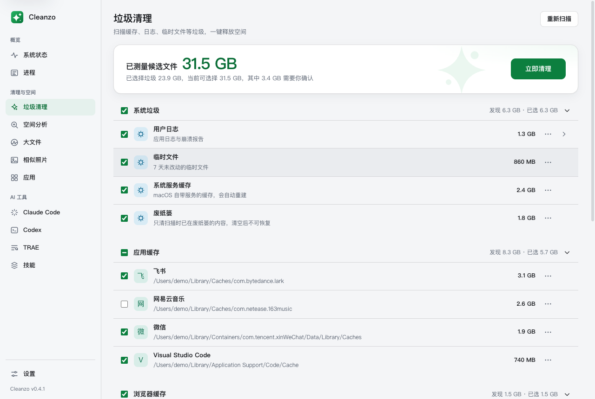

# Cleanzo

简体中文 | [English](README.en.md)

**看得懂 AI 和开发工具吃了多少空间，删了还能拿回来的 macOS / Windows 清理器。**

免费开源（MIT）· 原生 Go 单二进制，安装包约 5 MB · 不需要管理员权限 · 没有账号、没有遥测 · 清理前列出每一类，随时可以停

[](https://github.com/echoVic/cleanzo/releases)
[](LICENSE)




## 安装

macOS 可以用 Homebrew：

```sh
brew install --cask echoVic/tap/cleanzo
```

也可以从 [Releases](https://github.com/echoVic/cleanzo/releases) 下载：

- **macOS 12+（Apple 芯片）**：`cleanzo-<版本>-arm64.dmg`，打开后拖进「应用程序」。已用 Developer ID 签名并经 Apple 公证。
- **Windows 10/11 x64**：`cleanzo-setup-<版本>-amd64.exe`，按用户安装。需要 WebView2（Windows 11 自带）；安装包未签名时 SmartScreen 可能提示，选「更多信息」→「仍要运行」。

## 功能

- **垃圾清理**：按系统垃圾、应用缓存、浏览器缓存、更新残留、开发工具、需要确认和自定义目录分组，可以逐项展开、随时停止。可再生的缓存直接删除，你自己的文件只移进废纸篓。
- **AI 与开发工具**：Claude Code、Codex、TRAE 的会话和缓存，Ollama、HuggingFace、LM Studio 的本地模型，以及 npm、pnpm、Bun、uv、pip、Cargo、Go、Xcode 等缓存。模型默认不勾选。
- **Claude Code 的「运行中」和 agent worktree**（macOS）：列出开着的会话和已关闭的会话留下的进程（开发服务器这类，带端口），逐个确认后手动结束；Claude Code 和 Codex 在仓库里建的 worktree 可以整个移进废纸篓，分支留在仓库里，带着没提交改动的会写明，在用的不能勾选。
- **空间与文件**：磁盘用量和占最大空间的目录，可以展开、勾选后移入废纸篓；另有按大小扫描的大文件和相似照片分组。
- **应用**：一个列表看版本、占用、上次打开和 7 天增长；支持 App Store、Homebrew、Sparkle、electron-updater 的更新检查，也能卸载应用、找出残留。
- **系统状态与进程**（macOS）：芯片、内存、磁盘、网络、电池和散热读数；进程按 App 合并，看清谁在吃 CPU 和内存；菜单栏可以放 CPU、内存、网络等读数。
- **技能**：汇总 `~/.agents`、Claude Code、Codex、Gemini CLI、OpenCode 等工具的技能目录，标出失效软链、重复和已分叉的副本。
- **中英文界面**，可跟随系统；外观支持浅色、深色和跟随系统。

## 安全

删除只在用户主目录和用户临时目录内进行（Homebrew 自己执行的清理除外）；主目录、`~/Library`、文稿、桌面等用户文件夹本身，以及钥匙串、iCloud 和其他云盘同步目录、邮件、信息、照片图库、`~/.ssh` 都不碰。正在使用的文件、查不出占用的文件和运行中的应用会跳过；移进废纸篓的内容可以恢复。

## 开发

需要 Go（版本见 `go.mod`）和 Bun（版本见 `.bun-version`）。

```sh
bun install --frozen-lockfile
bun run dev        # 开发模式，带热更新
```

检查（与 CI 一致）：

```sh
test -z "$(gofmt -l .)" && go vet ./...
go test -race -count=1 ./...
bun run typecheck
bun run test:web
bun run build:web
```

`bun run build` 会签名并公证，需要 `mygo.config.ts` 里的 Developer ID 证书，只有存着证书的机器能完成；没有证书时用 `bun run build -- -sign=- -skip-notarize` 构建只给自己用的版本。Windows 用 `bun run build:windows`。图标以 `public/favicon.svg` 为源，改完运行 `bun run generate:icon`。

## 文档

- [CHANGELOG](CHANGELOG.md)：各版本变化
- [发版步骤](docs/RELEASING.md)：签名、公证和发布
- [Windows 测试素材](docs/qa/README.md)：实机报告与截图

## 致谢

- 把进程归到 Claude Code 会话的思路来自 [seshka](https://github.com/jigjoy-ai/seshka)（MIT）。

## 许可

[MIT](LICENSE)
