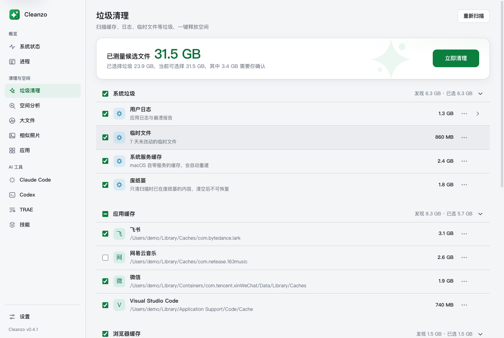
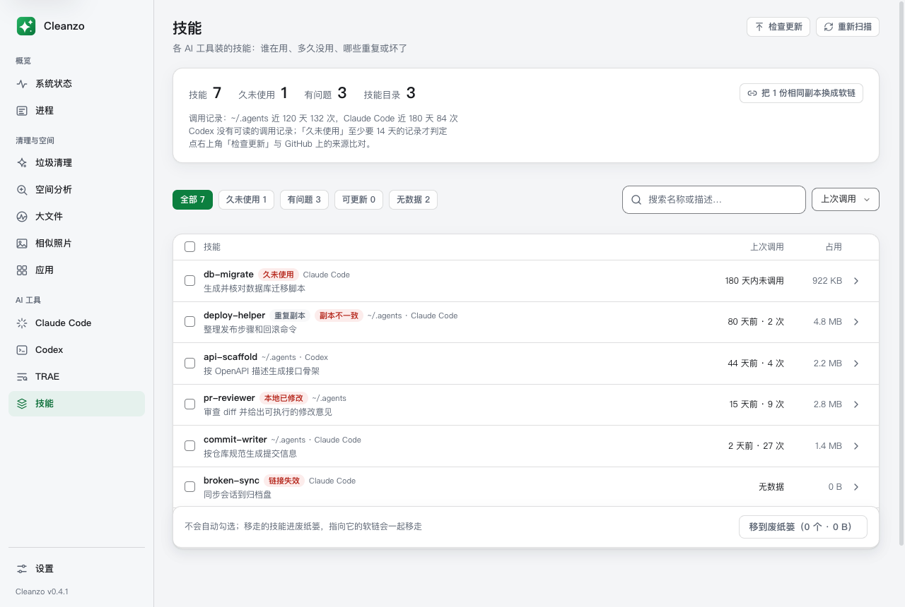

# Cleanzo

**看得懂 AI 和开发工具吃了多少空间，删了还能拿回来的 macOS / Windows 清理器。**

免费开源（MIT）· 原生 Go 单二进制约 8 MB · 不需要管理员权限 · 没有账号、没有遥测 · 清理前列出每一类，随时可以停

[](https://github.com/echoVic/cleanzo/releases)
[](LICENSE)




## 为什么用它

| | |
|---|---|
| **先看清，再动手** | 扫描结果按分组排列、可逐项展开；清理前列出「直接删除」和「移到废纸篓」两部分，确认后才动手，中途可以停。 |
| **删了能拿回来** | 缓存、日志直接删；**你自己的文件只会移进废纸篓**。钥匙串、iCloud 云盘、邮件、信息、照片图库、`~/.ssh` 一律不碰。 |
| **AI 和开发工具** | 看清 Claude Code、Codex、TRAE 的会话、旧版本和缓存各占多少；技能目录有没有重复、失效，或者被改花了。 |
| **不止清理** | Mac 上还能看系统状态、菜单栏读数、进程，以及「哪个 App 正在偷偷变大」，检查应用更新并在行内升级。 |



## 安装

```sh
brew install --cask echoVic/tap/cleanzo
```

没有 Homebrew，或者要装 Windows 版，从 [Releases](https://github.com/echoVic/cleanzo/releases) 下载：

- **macOS 12+（Apple 芯片）**：`cleanzo-<版本>-arm64.dmg`，打开后把 Cleanzo 拖进「应用程序」。DMG 已用 Developer ID 签名并经 Apple 公证。目前只支持 Apple 芯片（M 系列）的 Mac。
- **Windows 10/11 x64**：`cleanzo-setup-<版本>-amd64.exe`，按用户安装到 `%LOCALAPPDATA%\Programs\Cleanzo`。

Windows 需要 WebView2 Runtime（Windows 11 内置）；缺少时应用会提示并提供官方下载链接。未签名的构建可能触发 SmartScreen，确认下载来源后选择 **More info → Run anyway**（更多信息 → 仍要运行）。

## Windows

Windows 版提供系统状态、用户目录空间分析、垃圾清理、AI 工具、技能、大文件、相似照片和已安装应用列表。卸载应用会打开该注册表条目声明的卸载器；Cleanzo 不会删除或回收 InstallLocation，卸载结束后请刷新列表。

首版不支持应用残留清理、Store/MSIX 应用卸载（应用页可打开 Windows 设置）、HEIC、需要管理员权限的系统级清理，以及 arm64 原生构建。ARM 设备可通过 x64 仿真运行。自动更新后，Windows 设置中的应用版本仍可能显示首次安装时的版本。

## 功能

以下功能说明以 macOS 为准；Windows 的差异见上节。

- 垃圾清理按系统垃圾、应用缓存、浏览器缓存、更新残留、开发工具、需要确认、自定义目录分组；不存在的目标不显示，测量后为零的条目隐藏
- 应用缓存按应用合并 `~/Library/Caches`、沙盒容器和 Application Support 下的 Electron/Chromium 缓存；优先显示已安装应用的名字，认不出时显示目录名。Spotify、网易云音乐、QQ 音乐的缓存默认不勾选
- 浏览器规则只清缓存，不碰历史、Cookie、登录和书签；更新残留覆盖 ShipIt、Sparkle 和 updater 暂存目录
- 开发工具覆盖 npm/npx、pnpm、Yarn、Bun、uv、pip、Cargo、Go、Xcode 等缓存；下载代价大的 Playwright、Puppeteer、Go 模块、Gradle、Maven 缓存默认不勾选
- 工具自己管理的数据交给 `brew cleanup --prune=30`、`pnpm store prune`、`go clean -modcache`、`xcrun simctl delete unavailable`；报告估算或大小上限，工具缺失、忙碌、失败或超时不阻塞其他条目
- 需要确认的备份、固件、Xcode Archives、DeviceSupport、安装包、未完成下载、邮件附件和不可用模拟器默认不勾选；备份、归档等可展开逐个选择，DeviceSupport 各平台最新版默认保留
- 安装包递归扫描下载、桌面和文稿里的 DMG、PKG、MPKG、XIP（不区分扩展名大小写），所有年龄都列出且默认不勾选，最近变动天数仅作提示，不再用 30 天硬拦截；不进入软链、隐藏目录、应用和文档包内部，旧式 PKG/MPKG 目录整体移到废纸篓，普通文件夹不会作为安装包移走
- 扫描和清理显示逐项结果、占用最多的目录、进度与跳过原因，可随时停止；清理前确认永久删除和移到废纸篓的内容
- 空间分析：一进页面就显示磁盘用量；按占用排行展示大目录，可展开、勾选后移入废纸篓（流式进度，du 并发加速，可随时停止）；显示名称/后缀推断的类型和清理风险（仅供参考），移动失败的原因保留在页面；占用探测失败单独提示，不再冒充「应用正在运行」
- 系统状态（macOS）：首页只讲这台 Mac——型号、芯片和核数、GPU、内存、磁盘和显示器；散热状态、芯片温度、风扇转速和整机功耗；CPU（性能核、能效核分开）、GPU、内存、磁盘（SSD 型号、健康、寿命已用、累计写入、温度、读写速度）、网络（下载、上传速度）和电池（温度、电源功率）。都不需要管理员权限，只在首页开着时读；看谁在占 CPU 和内存去「进程」页
- 进程（macOS）：按 App 看谁在占 CPU 和内存，同一个 App 的进程合成一行，点开能看到里面的各个进程；系统和其他账户的进程也列出来，数字前带「≈」的是估算值。电脑卡的时候，顶上一句话说清是内存不够还是 CPU 太忙、占得最多的是谁。能退出 App；正常退出 5 秒还没退掉时，可以确认后强制退出。只在这一页开着时统计（每 2 秒一次，可以暂停），离开就停。「磁盘占用」标签就是占用增长：把每个 App 散在 `~/Library`、主目录下的点目录和 `/Library` 里的数据加起来，每天记一次，列出今天、7 天、30 天的增长，默认按 7 天增长排序；某个 App 一天涨超过 2 GB 或 7 天涨超过 10 GB 时发通知，写出是哪个目录（阈值可在设置里改）。打开后台监控后，关掉窗口 Cleanzo 会留在菜单栏，也可以开机启动；只量不删，主目录以外的目录只在 Finder 里显示，卸载走应用页现有的流程。没有完全磁盘访问权限时不量 Containers 和 Group Containers
- 菜单栏（macOS）：默认显示 CPU 和内存两个读数，上一行小字写名称、下一行写数值（网络是下载、上传两行），内存紧张时数值变橙色、严重时变红色；在设置的「菜单栏」一节还能打开 GPU、网络、磁盘可用空间、芯片温度和电池电量。每个读数是菜单栏里单独的一项，按住 ⌘ 可以各自拖到想放的位置；有读数时不再单独显示 Cleanzo 图标，右键点读数或点面板里的「⋯」是 Cleanzo 的菜单（打开窗口、菜单栏设置、退出）。点开任一读数是它的详情：原生界面，打开就是完整的面板；一句话说清忙不忙、谁占得最多，打开后一分钟的曲线和明细；CPU 和内存列出占得最多的 5 项（和「进程」页一样，App、命令行程序和系统进程都算），App 点两下就能退出，点名字打开「进程」页并定位到它；磁盘面板能直接去清理，打开后台监控时还列出涨得最快的 App。面板关着时只读勾选的读数，不读进程。有读数时，关掉窗口 Cleanzo 留在菜单栏，也可以开机启动
- 中英文界面：设置页可切换「跟随系统 / 中文 / English」，与 MyGo 原生菜单、更新窗口同步；保留旧版语言选择，「跟随系统」会响应系统语言变化。macOS 自带文件对话框等 AppKit 文案在重启应用后跟随新语言
- 大文件专清：扫描全盘找出大于所选大小（100 MB / 500 MB / 1 GB / 5 GB）的单个文件，可一键移入废纸篓（流式进度）
- 应用（macOS）：一个列表看所有 App，可按「全部 / 有更新 / 很久没用 / 残留」筛选，按名称、大小、上次打开或 7 天增长排序。进入页面时检查每个 App 有没有新版本：App Store、Homebrew cask、Sparkle 和 electron-updater 的更新源都认，版本按 App 包里的真实版本比，Chrome 这类自己会更新的 App 不会因为 Homebrew 记录旧而误报；检查会访问各 App 自己的更新服务器，只在这一页开着时进行。点开一行：版本和「更新」（Homebrew 装的由 Cleanzo 执行 `brew upgrade --cask`，App 在运行时先退出；其余打开 App Store 或 App 自己的更新）、占用（本体 / 数据 / 缓存，缓存可单独清）、退出、卸载。Homebrew 的版本信息来自本地缓存，可能比最新晚一天。残留找出已卸载应用遗留的 Library 数据，移入废纸篓前有安全提示，垃圾清理首页也显示残留汇总并可跳转
- 相似照片：找出完全相同和近似的照片分组，可点开看大图、前后翻看后再决定移走哪张
- 移入废纸篓后列表原地更新（父文件夹大小随之减少），不用重新扫描；正在使用的项保持勾选
- 设置即时保存：开关扫描分组、忽略或恢复条目，用系统文件夹选择框添加自定义目录；保存失败回滚，修改后提示重新扫描。配置写为 v3，读取旧 v1/v2 分类时保留停用选择和改过的路径
- 技能：汇总 ~/.agents、Claude Code、Codex、Gemini CLI、OpenCode 等工具的技能目录，从 Claude Code / Codex（含压缩归档）/ OpenCode 的对话记录统计调用次数和上次调用时间（只读，其余工具显示「无数据」），记录满 14 天才判定「久未使用」；标出失效软链、缺少 SKILL.md、重复和已分叉的副本，相同副本可换成指向 ~/.agents 的软链；移除前不预选，移到废纸篓，被软链引用的目录要连同软链一起移走
- 安全保护：文件删除只在用户主目录和用户临时目录内进行；唯一例外是 Homebrew 自己执行的清理命令。拒绝主目录、~/Library、文稿 / 桌面等用户文件夹本身，以及钥匙串、iCloud Drive、邮件、信息、照片图库、~/.ssh；判断前先解析符号链接并忽略大小写，`/etc`、`/tmp`、`/Users/me/library` 这类别名绕不过去
- 具体规则认领的路径不再计入通用应用缓存；忽略规则或关闭分组后，它们的路径仍然保留，不会被另一项清走。Spotlight、CloudKit、JetBrains、虚拟环境和模型目录等受硬保护名单保护
- 不碰正在使用的文件：被进程打开的文件和 socket（lsof）、以运行中应用的 bundle ID 命名的缓存都会跳过；临时目录只清理 7 天内没有改动、也没有被移入的条目；正在运行的应用不能卸载
- 「移到废纸篓」、照片清理和应用卸载走同一套安全检查；照片图库、iMovie 等应用自己管理的资料库不会被拆

macOS 设置中可开启「废纸篓提醒」（默认开启）：超过 1 GB 时在独立弹窗询问是否清空，可改为 2 / 5 / 10 GB 或关闭。后台每 5 分钟检查一次，启动后首次检查延迟 1 分钟，每 24 小时最多提醒一次，重启不会重置间隔。确认、清理进度、取消和结果都在弹窗内完成。取消会停止后续项目，已永久删除的内容无法恢复；提醒后新增或变化的项目会保留。需要完全磁盘访问权限，仅检查当前用户的 `~/.Trash`。关闭主窗口后继续检查，退出 Cleanzo 后停止。

## 开发运行

设置中的「外观」可以选择跟随系统、浅色或深色，选择会保存并在下次启动时恢复。

桌面图标、侧边栏标志和网页图标统一以 `public/favicon.svg` 为源文件。修改后运行 `bun run generate:icon` 更新 `resources/icon.png`（需要 librsvg 的 `rsvg-convert`，macOS 可用 `brew install librsvg` 安装）；MyGo 打包时再生成 ICNS 和 ICO。

```sh
bun run dev      # 开发模式，带热更新
```

## 构建打包

```sh
bun run build
# 产物：
#   build/darwin-arm64/Cleanzo.app
#   build/darwin-arm64/cleanzo-<v>-arm64.dmg
```

`bun run build` 会用 `mygo.config.ts` 里配置的 Developer ID 证书签名，并提交苹果公证，只有存着这张证书的机器能完成（发版步骤见 [docs/RELEASING.md](docs/RELEASING.md)）。没有证书时，构建一个 ad hoc 签名、不公证的版本，只适合在自己的 Mac 上用：

```sh
bun run build -- -sign=- -skip-notarize
```

版本号只写在 `mygo.config.ts` 一处：应用运行时从这里读（侧栏和设置页「关于」显示的版本），dmg 挂载后的卷名也带着它（「Cleanzo <v>」），同时挂着几个版本也分得清。

## 测试

Windows 实机测试报告、逐项结果与原始截图见 [测试素材索引](docs/qa/README.md)。

```sh
gofmt -l .         # 应无输出
go vet ./...
go test -race -count=1 ./... # 扫描/清理逻辑单测（临时目录，不清理真实文件）
bun run generate   # 从 Go 服务重新生成绑定
bun run typecheck  # 前端类型检查
bun run build:web  # 前端生产构建
bun run test:web   # 前端单测（bun test，无浏览器的事件夹具）
```

## 注意事项

- 可再生的缓存、日志、临时文件、更新残留等**直接删除**；自定义目录、备份、归档、安装包、未完成下载、邮件附件，以及大文件、残留、照片和应用卸载都**移到废纸篓**，可以恢复。确认弹窗会分别列出两部分
- 同时勾选「废纸篓」时会先清空废纸篓，这次移进去的文件仍可恢复
- 没有「完全磁盘访问权限」时不进入其他应用的沙盒数据；废纸篓、iOS 备份、邮件附件显示需要授权，首页提示还有多少沙盒应用可扫描，设置页可查看权限并打开系统设置
- 支持 macOS 12+（Apple 芯片）和 Windows 10/11 x64
- 扫描耗时取决于目录和文件数量；规则先展开显示，目录测量在有上限的并发池内进行

## 技术要点

- Go 侧 `Cleaner` 服务暴露给前端，自动生成类型化 TS 客户端（`src/mygo.ts`），前端调用 `Cleaner.scanJunk()` / `Cleaner.cleanJunk()`，经 Channel 边做边报进度
- 技能页在 `skills.go`（扫描、调用记录、移除与换成软链）与 `src/react/skills/`
- 规则表集中在 `rules.go`；`junk.go` 负责认领、展开、测量和清理，`owners.go` 负责应用归属，`tools.go` 负责工具命令
- 清理边界由规则的目标模式决定：目录内容保留根目录，匹配目标可移除目标本身；自定义目录只把内容移到废纸篓。子项选择必须仍是该条目的当前候选路径
- `settings.go` 负责设置校验、v1/v2 迁移和原子保存；前端垃圾清理与设置分别在 `src/react/clean/` 和 `src/react/settings/`

## 后续可扩展

- 增量扫描和测量缓存
- 更多已知缓存位置；Docker、虚拟机、模型文件和聊天媒体不在当前清理范围内
- 磁盘占用可视化（占比图）
- 清理历史与撤销（移入废纸篓而非直接删除）

## 许可证

[MIT](LICENSE)
