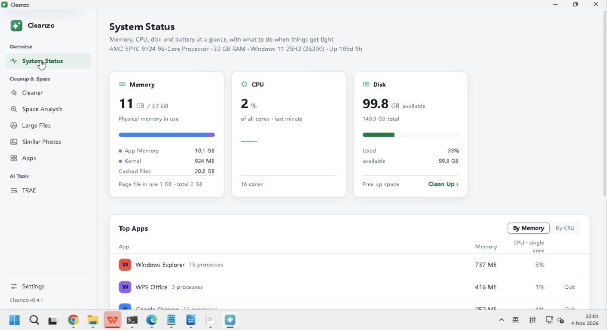

# Cleanzo 0.4.1 Windows 实机测试报告

2026-11-04 · Windows 11 Pro 25H2 x64 · 公开发布 0.4.1

后续调查、源码修复与图标复测另见 [fix_validation.md](fix_validation.md)。下文保留原始测试时的判定。

本轮计划 18 项：**8 通过、2 失败、8 部分完成、0 未执行**。两条失败对应 **1 个确认缺陷 D01**。主要只读流程与本次禁用 hover 修复通过实测，但深色原生菜单存在可读性问题，图标升级显示及若干边界未闭环，**不满足全项无缺陷准出条件**。不能将本报告理解为全功能验收通过。

安装器完成旧版 0.2.4 → 0.4.1 升级，已安装二进制与公开发布包哈希一致。此次为 Windows VM 中实际应用操作；不以过去 CI 或前端 mock 的结果代替本轮原生实测。

## 主要结论

- 侧边栏分组、选中态、低高度独立滚动及固定页脚正常。窄窗口和低高度键盘全链路尚未测。
- TRAE 真实禁用清理按钮的浅色、深色悬停稳定；启用按钮保留悬停反馈。
- 真实系统采样、垃圾扫描、空间目录展开、大文件保护、应用搜索排序和检查更新均观察到有效结果。扫描取消与数据变更流程没有完整覆盖。
- 正常退出确认主进程结束；重开后深色和中文保存。最终恢复 System 外观、System 语言。
- D01：深色原生语言和排序下拉菜单白底近白字，P2；同一问题在两个控件复现。
- O01：升级后桌面/任务栏旧蓝色与应用内新绿色不一致，二进制图标和快捷方式目标已核对，成因待核实。

完整步骤与截图见 [findings.md](findings.md)。

## 逐项结果

| ID | 项目 | 判定 | 实际结果与未闭环部分 | 证据 |
| --- | --- | --- | --- | --- |
| W01 | 环境与构建身份 | 通过 | 已从 0.2.4 升级至公开 0.4.1；安装包及已安装 exe 的 SHA256 均匹配本地发布包。About、侧栏和应用列表显示 0.4.1。 | [图1](screenshots/02-installer-hash-raw.png)、[图2](screenshots/07-install-complete-raw.png)、[图3](screenshots/29-installed-hash-raw.png) |
| W02 | 系统状态真实采样 | 通过 | 系统状态显示真实 32 GB 内存、16 核、149.9 GB 磁盘及用户运行程序；CPU 3→1%、后续 5→2%，内核内存持续变化，实时采样可见。仅证明采样显示，不是性能基准。 | [图1](screenshots/41-final-system-status-raw.png)、[图2](screenshots/34-restart-dark-zh-raw.png) |
| W03 | 侧边栏分组与选中态 | 通过 | 概览、清理与空间、AI 工具分组及选中态正常；遍历系统状态、垃圾清理、空间分析、大文件、相似照片、应用、TRAE、设置。Windows 隐藏进程页；AI/技能入口由本机目录条件决定。 | [图1](screenshots/41-final-system-status-raw.png)、[图2](screenshots/19-cleaner-completed-raw.png)、[图3](screenshots/39-large-files-completed-raw.png) |
| W04 | 低高度与窄窗口 | 部分完成 | 约 430 px 低高度窗口中导航独立滚动，底部设置和版本固定、下部入口可达。未完成窄宽度及低高度键盘焦点全程验证。 | [图1](screenshots/13-short-window-footer-raw.png)、[图2](screenshots/14-sidebar-scroll-footer-raw.png) |
| W05 | 图标一致性 | 部分完成 | 窗口、侧栏和更新弹窗是绿色新图标；升级后桌面和任务栏仍蓝色，正常重启后不变。快捷方式指向已核实的新 exe，IconLocation 为 ,0；本地同哈希 exe 的嵌入图标为绿色。Shell 缓存相关原因尚未实证。 | [图1](screenshots/30-desktop-icon-raw.png)、[图2](screenshots/31-window-moved-raw.png)、[图3](screenshots/24-update-latest-raw.png)、[图4](screenshots/40-shortcut-target-raw.png)、[图5](artifacts/release-exe-embedded-icon.png) |
| W06 | 禁用按钮 hover | 通过 | 真实 TRAE 0 B 清理按钮处于禁用态；深色和浅色分别观察悬停前后，背景、文字和图标没有错误 hover 变化。 | [图1](screenshots/22-trae-disabled-before-raw.png)、[图2](screenshots/23-trae-disabled-hover-raw.png)、[图3](screenshots/37-light-disabled-before-raw.png)、[图4](screenshots/38-light-disabled-hover-raw.png) |
| W07 | 启用控件与键盘反馈 | 部分完成 | 启用按钮有正常绿色 hover；Tab 从应用搜索进入排序，方向键更改排序，Enter 操作菜单及关闭更新弹窗。未验证 Space 激活。没有执行卸载。 | [图1](screenshots/17-dark-disabled-hover-raw.png)、[图2](screenshots/28-dark-sort-menu-raw.png)、[图3](screenshots/24-update-latest-raw.png) |
| W08 | 深浅主题与保存 | 失败 | 深浅主题切换和重开保存正常；深色原生下拉菜单出现白底近白字，选项难以辨认，D01。原 System 外观已恢复。 | [图1](screenshots/11-dark-language-menu-raw.png)、[图2](screenshots/28-dark-sort-menu-raw.png)、[图3](screenshots/34-restart-dark-zh-raw.png)、[图4](screenshots/36-system-settings-restored-raw.png) |
| W09 | 中英文切换 | 失败 | 中文/English 切换和重开语言保存正常；深色语言菜单中文/English 选项对比度不足，D01 同一缺陷。原 System 语言已恢复。 | [图1](screenshots/11-dark-language-menu-raw.png)、[图2](screenshots/12-dark-zh-settings-raw.png)、[图3](screenshots/34-restart-dark-zh-raw.png)、[图4](screenshots/36-system-settings-restored-raw.png) |
| W10 | 垃圾扫描与取消 | 部分完成 | 垃圾只读扫描完成 271 MB，默认选中 55.4 MB；运行中浏览器 131 MB 被阻止，分类和重扫正常。停止点击与快速完成竞态，不能证明取消成功；未做真实清理。 | [图1](screenshots/18-cleaner-scanning-raw.png)、[图2](screenshots/19-cleaner-completed-raw.png)、[图3](screenshots/20-cleaner-stop-attempt-raw.png) |
| W11 | 空间分析 | 部分完成 | 空间分析完成，Local 9.7 GB、Roaming 4.0 GB、Downloads 1.5 GB 按大小排序；Local 展开可见 Programs、Kingsoft 等及保护标记。零选择禁用正常；未验证取消及打开 Explorer。 | [图1](screenshots/25-space-ranking-raw.png)、[图2](screenshots/26-space-expanded-raw.png) |
| W12 | 大文件 | 部分完成 | 默认 1 GB 阈值只读扫描及重扫完成，31 files、0.9 s、0 skipped，发现 1.4 GB TRAE ZIP 并标为 Protected。未变更阈值、验证可选样本或精确边界夹具。 | [图1](screenshots/39-large-files-completed-raw.png) |
| W13 | 相似照片 | 部分完成 | 相似照片入口正常并自动得到没有发现相似照片的空状态。本环境无明确 QA 图片夹具，分组、预览和切换未测。 | [图1](screenshots/21-photos-empty-raw.png) |
| W14 | Windows 应用页 | 通过 | Windows 应用列表、cleanzo 搜索、条目展开和大小排序正常；Cleanzo 版本 0.4.1，Edge 2.8 GB、飞书 1.6 GB、WPS 1.3 GB。部分 0 B 来自注册表 EstimatedSize，图标字母为现行回退。菜单对比度缺陷记 D01/W08/W09。未执行卸载。 | [图1](screenshots/15-windows-app-list-raw.png)、[图2](screenshots/16-self-app-expanded-raw.png)、[图3](screenshots/27-app-search-raw.png)、[图4](screenshots/28-dark-sort-menu-raw.png) |
| W15 | AI 工具与技能 | 部分完成 | 本机可见 TRAE 入口，扫描 65.7 MB、3 项保护、最多释放 0 B，24 小时内内容保留；未清理真实数据。Claude Code、Codex 和技能对应目录不存在，未使用夹具覆盖。 | [图1](screenshots/22-trae-disabled-before-raw.png)、[图2](screenshots/37-light-disabled-before-raw.png) |
| W16 | 原生窗口 | 通过 | 正常最小化并从任务栏恢复、最大化/还原、调整高度、拖动窗口均正常；此次最终前台恢复至最大化系统状态页。未覆盖多屏或 DPI 矩阵。 | [图1](screenshots/13-short-window-footer-raw.png)、[图2](screenshots/31-window-moved-raw.png)、[图3](screenshots/41-final-system-status-raw.png) |
| W17 | 手动检查更新 | 通过 | 手动检查更新显示 Cleanzo 0.4.1 已是最新版本，弹窗绿色新图标正常，Enter 可关闭。未触发自动更新下载或安装。 | [图1](screenshots/24-update-latest-raw.png) |
| W18 | 正常重启与结束状态 | 通过 | 0.4.1 正常 Alt+F4 后主进程查无结果；退出后完成本地 WebView 数据备份，Cookies 源/备份哈希一致。重开深色+中文保存成功，最后恢复 System/System、关闭本轮辅助终端并保留 Cleanzo 系统状态。 | [图1](screenshots/32-process-exited-raw.png)、[图2](screenshots/33-closed-backup-raw.png)、[图3](screenshots/34-restart-dark-zh-raw.png)、[图4](screenshots/36-system-settings-restored-raw.png)、[图5](screenshots/41-final-system-status-raw.png) |

## 覆盖边界

- 实测一次现有用户环境的 0.2.4→0.4.1 升级；未测首次干净安装、卸载、回滚、自动更新与差分应用。安装器无 SmartScreen 弹窗仅是此次观察，不能推广至所有机器。
- 系统只覆盖 Win11 x64 build 26200；Win10、ARM64、多屏、DPI、长时间稳定性、断网与磁盘满未测。系统采样没有做性能基准或与独立工具逐值校验。
- 没有真实删除、移动到回收站、回收站恢复、终止用户程序或卸载应用；没有数据损失结论。
- 垃圾扫描停止点击与完成竞态，取消效果未证明；空间分析取消未测。大文件精确字节边界/可选 QA 样本、相似照片分组/预览、Claude/Codex/技能目录夹具、Space 操作未测。
- Windows 没有独立进程页是当前平台条件；未安装的 AI 目录隐藏入口符合代码条件，不能按 macOS 截图判缺陷。
- 应用占用取注册表 EstimatedSize，0 B 不等同磁盘实际无占用；现行 Windows 应用图标是字母回退。
- 输入通道批量仅送首字、IME 消费输入、初始截图裁切/旧帧、扫描取消竞态均作为测试限制，不判为产品错误。截图 17 文件名含 disabled，但实际是启用卸载按钮，只用于启用 hover，未执行卸载。截图 35 尚为中文，不用于最终语言恢复断言。

## 结束状态

Cleanzo 已最大化留在系统状态页，System 外观及 System 语言恢复（English/浅色），六类扫描范围及空自定义目录保持原值。已关闭本轮辅助 PowerShell 窗口，保留用户其他终端和云桌面连接；恢复外层浏览器默认视口。

远端保留本轮官方下载的安装包和两个 QA 备份目录，位置及完整性见 [environment.md](environment.md)。没有创建删除夹具、没有执行产品源码改动、提交或发布。

证据保留原图；三张 desktop 图按观察的画面范围裁剪、统一至 1408×768，原图未覆盖。[report.jsonl](report.jsonl) 是 0.4.1 实际结果追加日志；0.2.4 准备记录另存，避免混合构建。审计文件 [audit.json](audit.json) 核对计划、最终状态和证据路径，只证明计数与文件存在，截图含义已人工核对确认缺陷和关键结果。

